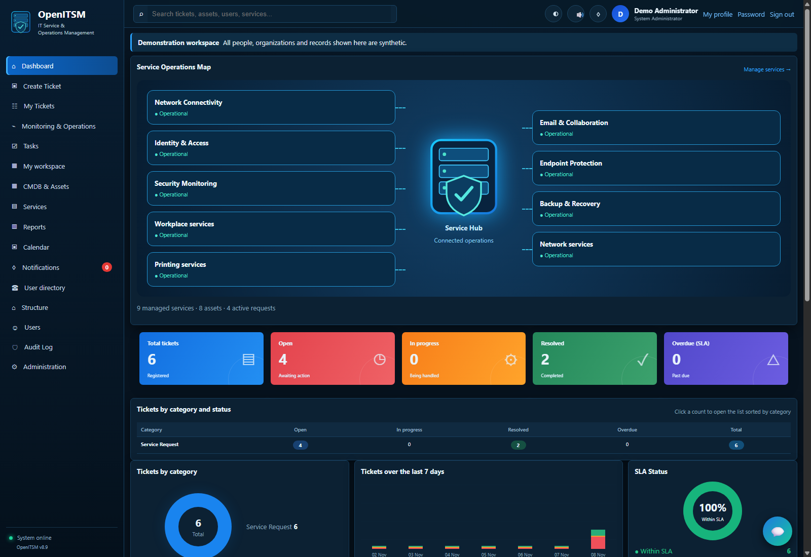
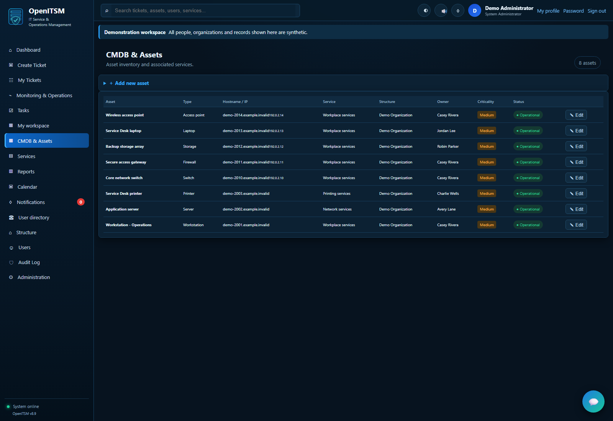
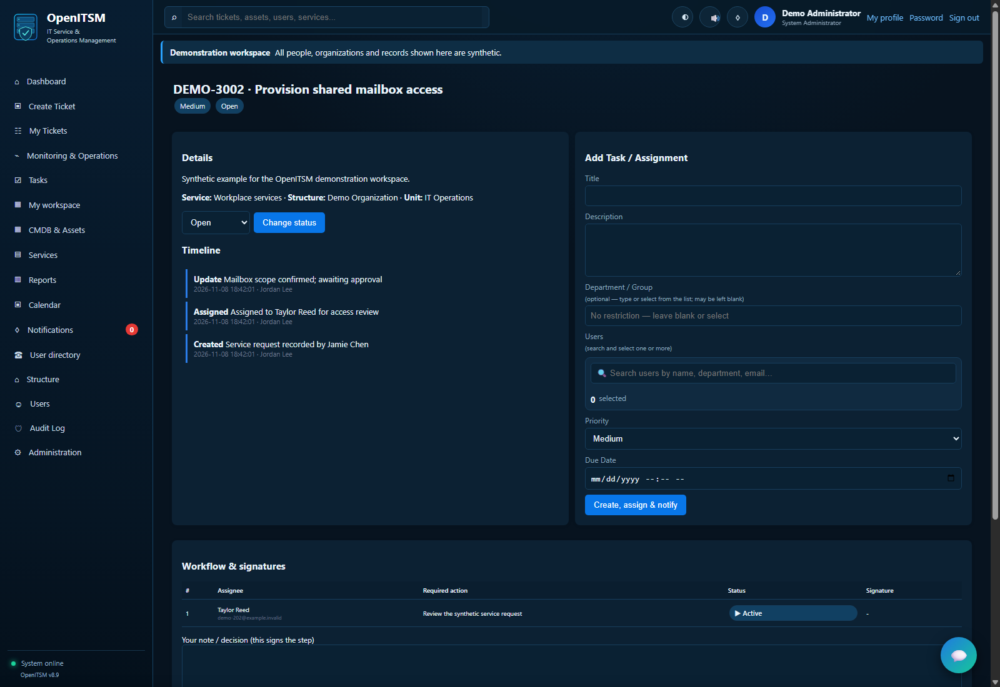
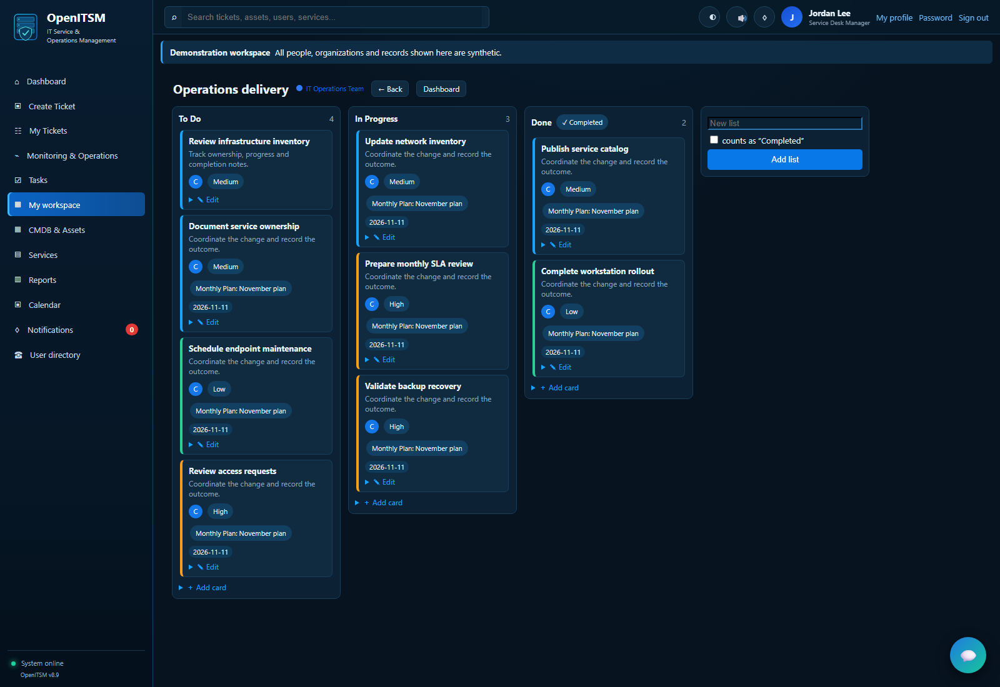
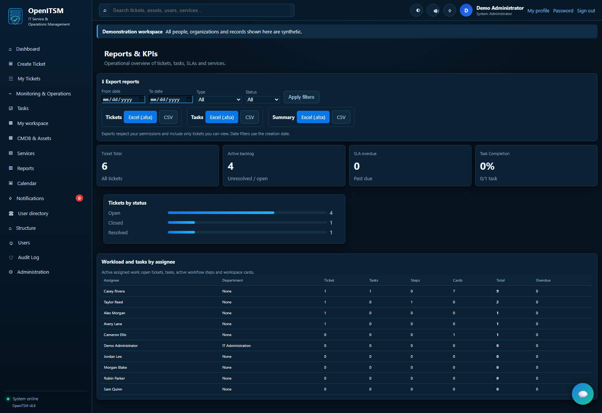
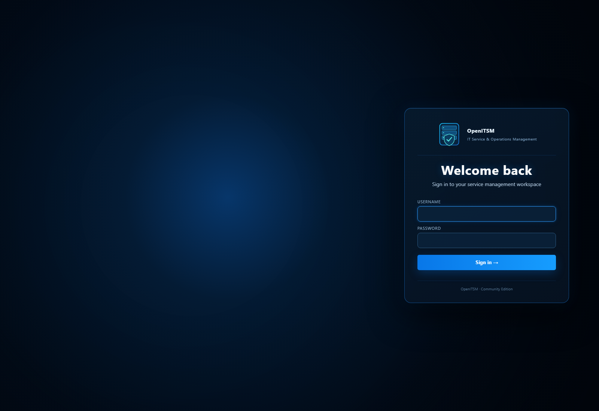

# OpenITSM

OpenITSM is an open-source IT service management platform for organizations that need a shared place to manage assets, report incidents, create service requests, and coordinate IT work.

**New to GitHub or Python? [Start with the beginner installation guide](INSTALLATION_GUIDE.md).** It explains every step, from Download ZIP to your first login.

Copyright 2026 Roland Cobi. Licensed under [Apache License 2.0](LICENSE); see [NOTICE](NOTICE) and [third-party notices](THIRD_PARTY_NOTICES.md).

## Capabilities

- IT asset and service records.
- Tickets, tasks, assignments, comments, and workflow signatures.
- Organization units, scoped roles, and object-level access controls.
- Personal and team workspaces with explicit membership permissions.
- Bilateral chat, notifications, audit records, and scoped reports/exports.

Only System Administrator is operationally global. Unit scope, ownership, role permissions, CSRF checks, and session revocation remain authoritative.

## Screenshots

Real browser captures of the English interface using an isolated synthetic demonstration workspace. People, organizations, addresses and records shown here are fictional.

### Service operations dashboard



| Asset inventory | Ticket workflow |
| --- | --- |
| [](docs/images/assets.png) | [](docs/images/ticket-workflow.png) |

| Team workspace | Reports and exports |
| --- | --- |
| [](docs/images/team-board.png) | [](docs/images/reports.png) |

<details>
<summary>Sign-in page</summary>



</details>

See [screenshot details](docs/SCREENSHOTS.md). These images illustrate the engineering preview; they do not represent a production deployment.

## Project status

OpenITSM is an **engineering preview**. The Windows source candidate OpenITSM-rc-001 passed a clean installation and both complete 216-test regression gates. The English interface update passed the complete 223-test gate (the original 216 identities plus seven English UI regressions); see [English update validation](docs/ENGLISH_UI_UPDATE.md). This is bounded internal validation, not independent security certification or production approval.

The [candidate validation report](VALIDATION.md) records the exact ZIP and SHA-256. [Public release readiness](RELEASE_READINESS.md) identifies remaining review and hosting decisions.

This repository documentation is newer than the frozen candidate archive. The GitHub community files prepared here are not inside that archive. A future GitHub-generated source archive is a different artifact and must not be described as the validated ZIP.

## Installation for evaluation

For a click-by-click walkthrough with first login, restarts, and troubleshooting, use the [beginner installation guide](INSTALLATION_GUIDE.md).

Validated profile: **Windows x64 / CPython 3.14.7 / Flask 3.1.3**, one process and local SQLite/WAL. Other platforms and infrastructure profiles are not certified by these results.

From a fresh checkout or the separately validated source archive:

```powershell
py -3.14 -m venv .venv
.venv\Scripts\python.exe -m pip install --only-binary=:all: --require-hashes -r requirements-tools-windows-py314.lock
.venv\Scripts\python.exe -m pip install --only-binary=:all: --require-hashes -r requirements-windows-py314.lock
.venv\Scripts\python.exe -m pip check
```

The lockfiles select exact Windows/Python wheels. Keep the hash checks; do not remove them to bypass an incompatible installation. Use a temporary synthetic database for first evaluation.

Provision a stable ITSM_SECRET_KEY and, for an empty users table, ITSM_INITIAL_ADMIN_PASSWORD through the process environment. The application does not automatically load .env. Follow [.env.example](.env.example) and the [start/stop/backup/recovery runbook](docs/P1_07_RUNBOOK.md). Importing the legacy app entry initializes configured storage, so avoid default imports against site data.

## Verification

```powershell
.venv\Scripts\python.exe tests\run_suites.py --suite all --list
.venv\Scripts\python.exe tests\run_suites.py --suite all --output-dir test-results\first-full
```

Use a fresh output directory. The full gate requires installed Edge and Chrome plus loopback HTTPS/SMTP listeners. Missing prerequisites are NOT_EXECUTED, not a passing skip. Subsets provide focused feedback and never certify the full gate. See [test commands](docs/P1_06_TESTING.md).

The existing legacy full runner remains available. It overwrites the two root Phase 0 artifacts; follow the preservation procedure in [the regression plan](TESTING.md).

## Security and operational limits

Read [SECURITY.md](SECURITY.md) before reporting vulnerabilities. Private reporting is not configured by these local files. Do not place credentials, site databases, personal information, or unfixed vulnerability details in public issues.

SMTP and backup workers are best effort. Daily backups do not replace an existing same-day snapshot; restoring a snapshot loses later writes. Audit export retains a 20,000-row cap. Browser/localization coverage is partial. Real site grants, certificate trust, SMTP AUTH, OS permissions, shutdown, capacity, and recovery need site validation. Proxy/multi-process/network SQLite and arbitrary historical forks remain outside the verified profile.

## Community and documentation

- [Contribution guide](CONTRIBUTING.md)
- [Support and bug reports](SUPPORT.md)
- [Code of conduct](CODE_OF_CONDUCT.md)
- [Architecture and security contracts](docs/ARCHITECTURE_AND_SECURITY_CONTRACTS.md)
- [Engineering history and evaluation details](VALIDATION.md)
- [GitHub preparation and release checklist](docs/GITHUB_RELEASE_PREPARATION.md)
- [Engineering release notes](CHANGELOG.md)

Repository visibility, release publication and production deployment are separate decisions. Updating the repository does not deploy the application.
